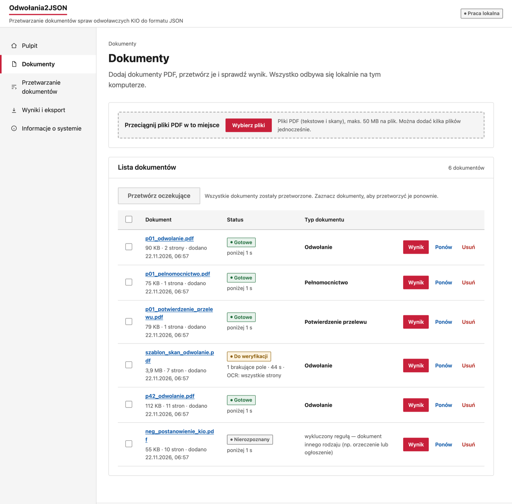
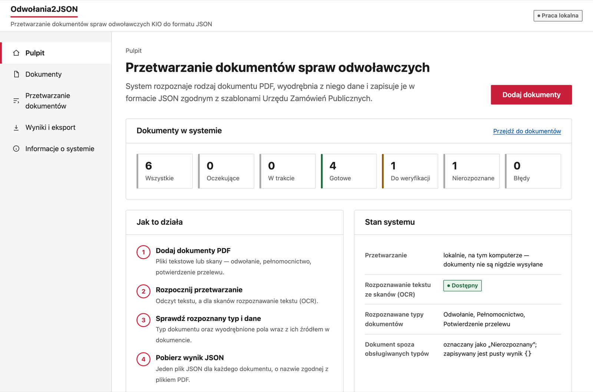
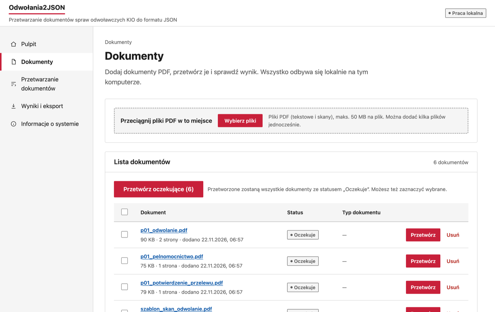
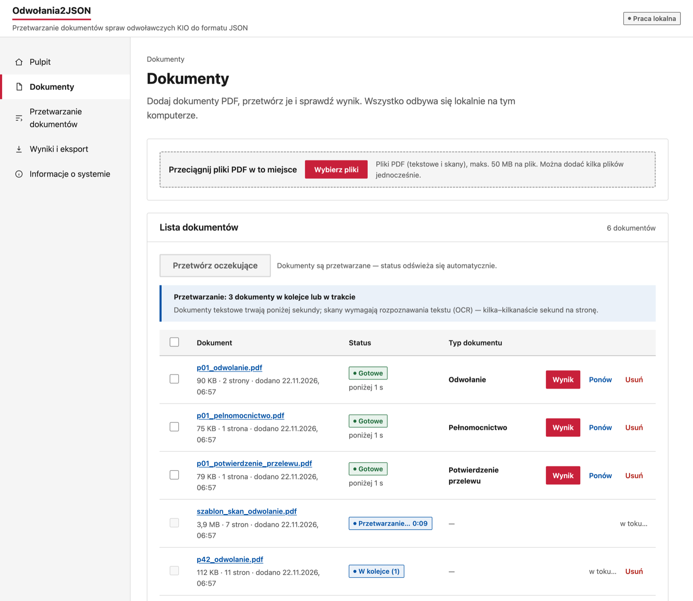
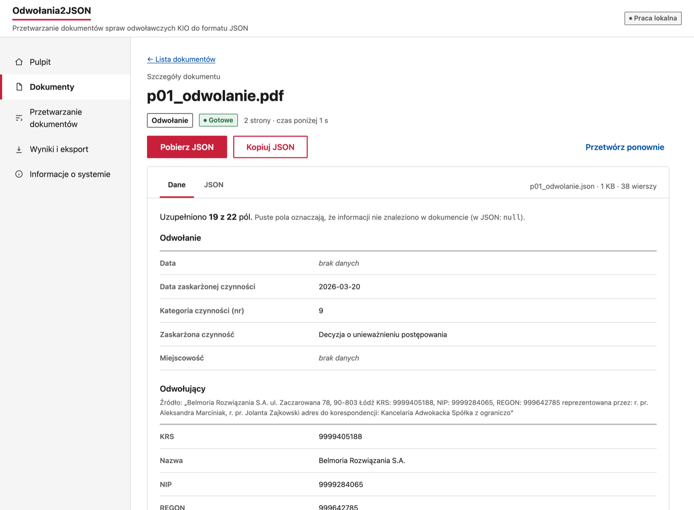
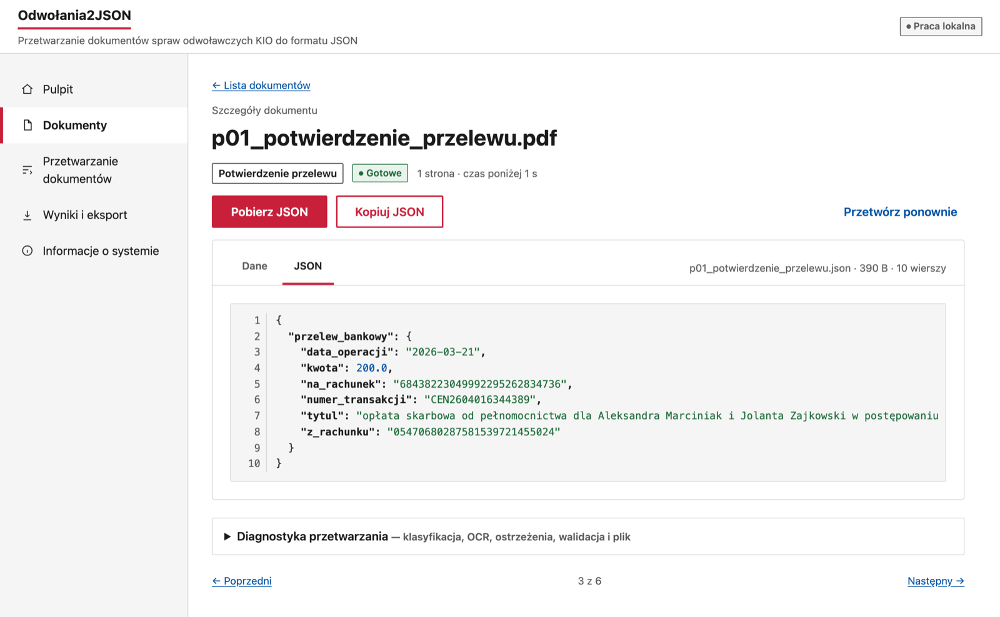
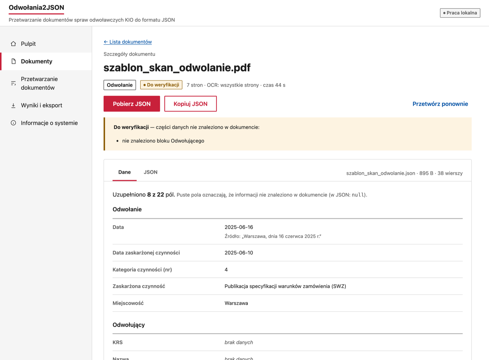
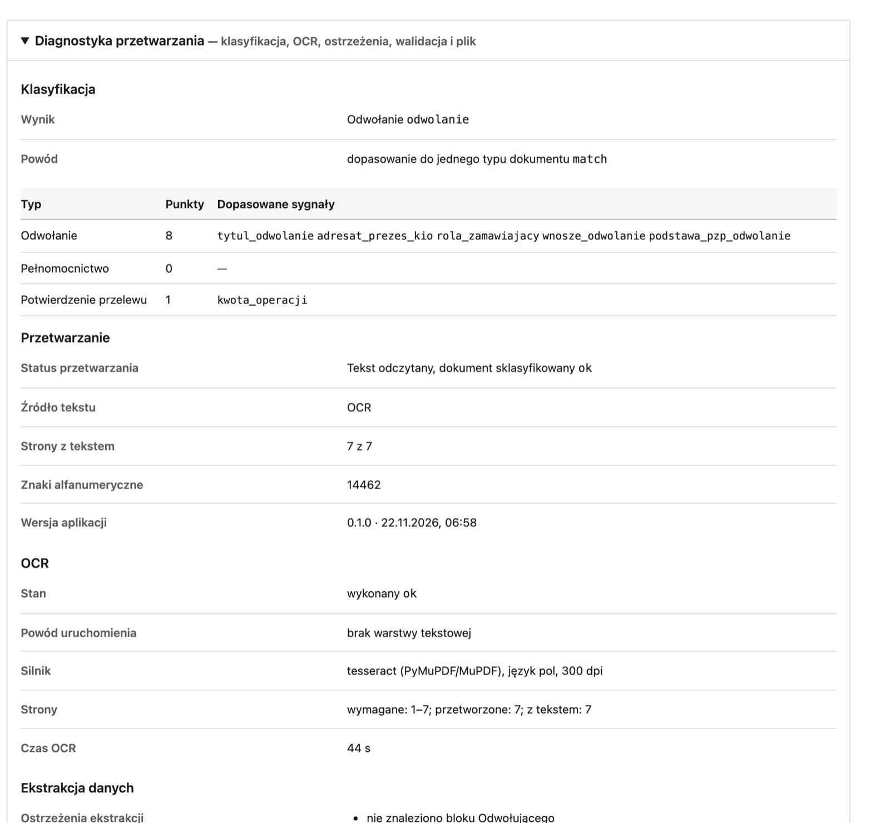
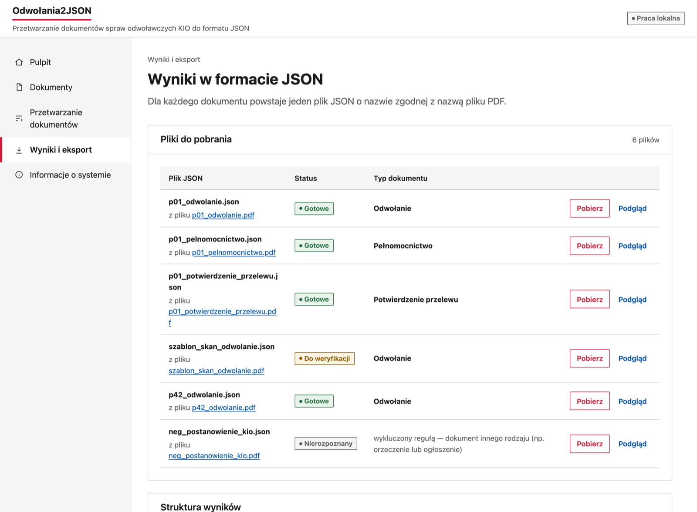

<div align="center">

# Odwołania2JSON

**Dokumenty sprawy odwoławczej KIO (PDF) → ustrukturyzowany JSON. Lokalnie, na zwykłym laptopie, bez chmury.**

Rozwiązanie zadania Urzędu Zamówień Publicznych · HackNation 2026




**🎬 [Zobacz film: jak korzystać z aplikacji (1:43)](docs/video/odwolania2json-tutorial.mp4)**

</div>

---

## Spis treści

- [Co robi aplikacja](#co-robi-aplikacja)
- [Możliwości w obrazkach](#możliwości-w-obrazkach)
- [Instalacja krok po kroku](#instalacja-krok-po-kroku)
- [Pierwsze uruchomienie (5 minut)](#pierwsze-uruchomienie-5-minut)
- [Tryb wsadowy (wiersz poleceń)](#tryb-wsadowy-wiersz-poleceń)
- [Rozwiązywanie problemów](#rozwiązywanie-problemów)
- [Jak to działa w środku](#jak-to-działa-w-środku)
- [Testy i wyniki](#testy-i-wyniki)
- [Ograniczenia](#ograniczenia)
- [Struktura projektu](#struktura-projektu)

---

## Co robi aplikacja

Sprawa odwoławcza przed Krajową Izbą Odwoławczą to zbiór plików PDF: tekstowych i skanowanych. Są wśród nich
odwołanie, pełnomocnictwo i potwierdzenie przelewu, a często także dokumenty, które do żadnej z tych grup nie należą.
Odwołania2JSON **rozpoznaje rodzaj każdego dokumentu** i **wyodrębnia z niego dane** do pliku JSON w formacie
organizatora.

| | |
|---|---|
| 📄 **Rozpoznaje typ dokumentu** | odwołanie · pełnomocnictwo · potwierdzenie przelewu · „nierozpoznany” |
| 🔎 **Wyodrębnia dane** | strony postępowania, NIP/KRS/REGON, daty, zaskarżone czynności, kwoty, rachunki, pełnomocników… |
| 🖨️ **Czyta skany** | wbudowany OCR języka polskiego — nie trzeba instalować Tesseracta |
| 🔒 **Działa lokalnie** | bez internetu, bez LLM, bez zewnętrznych API; dokumenty nie opuszczają komputera |
| 🧾 **Pokazuje, skąd wziął dane** | przy każdej wartości widać fragment dokumentu, z którego pochodzi |
| ⚙️ **Dwa tryby** | wygodna aplikacja w przeglądarce **albo** przetwarzanie całych folderów jednym poleceniem |

---

## Możliwości w obrazkach

### Pulpit — wszystko w jednym miejscu

Liczniki dokumentów, stan systemu (w tym dostępność OCR) i krótka instrukcja w czterech krokach.



### Dodawanie dokumentów — przeciągnij i upuść

Przeciągnij pliki PDF na pole albo kliknij **Wybierz pliki**. Możesz dodać wiele plików naraz, także skany.
Jeden przycisk **Przetwórz oczekujące** uruchamia całą partię.



### Przetwarzanie na żywo

Statusy odświeżają się same: *W kolejce* → *Przetwarzanie…* (z licznikiem czasu) → *Gotowe*. Dokumenty
tekstowe są gotowe w ułamku sekundy. Skany przechodzą przez OCR i trwa to od kilku do kilkunastu sekund na stronę.
Każdy dokument jest przetwarzany w osobnym procesie z limitem czasu, więc problem z jednym plikiem nie zatrzymuje reszty.



### Wynik: czytelne dane ze źródłem

Zakładka **Dane** pokazuje wyodrębnione pola po polsku, z informacją, ile pól udało się uzupełnić. Przy blokach
danych widać fragment dokumentu, z którego pochodzą. Na górze są przyciski **Pobierz JSON** i **Kopiuj JSON**.



### Wynik: dokładny plik JSON

Zakładka **JSON** pokazuje dokładnie ten plik, który zostanie pobrany. Ma kolorowanie składni i numery wierszy.



### Skany i dokumenty do weryfikacji

Gdy części danych nie da się odczytać, na przykład ze słabego skanu, dokument dostaje status **Do weryfikacji**.
Aplikacja pokazuje wtedy dokładnie, czego brakuje.



### Diagnostyka: dlaczego taka decyzja?

Pełna przejrzystość. Widać punkty i dopasowane sygnały dla każdego typu dokumentu, źródło tekstu (warstwa PDF lub
OCR), strony objęte OCR i jego czas, ostrzeżenia ekstrakcji oraz wynik walidacji.



### Wyniki i eksport

Wszystkie gotowe pliki JSON w jednym widoku. Nazwa każdego pliku odpowiada nazwie PDF-a (`odwolanie.pdf` →
`odwolanie.json`). Dokument nierozpoznany daje zgodnie z formatem organizatora pusty wynik `{}`.



---

## Instalacja krok po kroku

> Potrzebujesz tylko **Pythona 3.13 lub nowszego** i ok. 300 MB miejsca. Internet jest potrzebny wyłącznie podczas
> instalacji. Karta graficzna nie jest potrzebna.

### Krok 1. Zainstaluj Pythona 3.13+

<details open>
<summary><b>🪟 Windows</b></summary>

1. Wejdź na <https://www.python.org/downloads/> i pobierz najnowszy **Python 3.13** (lub nowszy).
2. Uruchom instalator i **koniecznie zaznacz „Add python.exe to PATH”** na pierwszym ekranie.
3. Kliknij **Install Now**.
4. Sprawdź: otwórz *Wiersz polecenia* (klawisz Windows → wpisz `cmd` → Enter) i wpisz:

   ```bat
   py -3.13 --version
   ```

   Powinno się wyświetlić `Python 3.13.x`.

</details>

<details open>
<summary><b>🍎 macOS</b></summary>

1. Wejdź na <https://www.python.org/downloads/> i pobierz instalator **macOS 64-bit universal2** dla Pythona 3.13.
2. Otwórz pobrany plik `.pkg` i przejdź przez instalator.
3. Sprawdź w aplikacji *Terminal* (⌘ + Spacja → wpisz „Terminal”):

   ```bash
   python3.13 --version
   ```

   Jeśli używasz Homebrew, wystarczy `brew install python@3.13`.

</details>

<details open>
<summary><b>🐧 Linux</b></summary>

Ubuntu 24.04+ / Debian:

```bash
sudo apt install python3.13 python3.13-venv
```

Fedora: `sudo dnf install python3.13`. Sprawdź: `python3.13 --version`.

</details>

### Krok 2. Pobierz projekt

**Najprościej (bez Gita):** na stronie repozytorium kliknij zielony przycisk **Code → Download ZIP**, a potem
rozpakuj archiwum, np. na Pulpit.

**Z Gitem:**

```bash
git clone https://github.com/Molendakrol/odwolania2json.git
```

### Krok 3. Zainstaluj zależności (jednorazowo)

Otwórz terminal **w folderze projektu**:

- Windows: otwórz folder w Eksploratorze, kliknij pasek adresu, wpisz `cmd` i naciśnij Enter;
- macOS: w Terminalu wpisz `cd `, przeciągnij folder do okna i naciśnij Enter.

Następnie wpisz dwa polecenia.

**Windows**

```bat
py -3.13 -m venv .venv
```

```bat
.venv\Scripts\pip install -r requirements.txt
```

**macOS / Linux**

```bash
python3.13 -m venv .venv
```

```bash
.venv/bin/pip install -r requirements.txt
```

To wszystko. Instalowany jest tylko jeden pakiet (**PyMuPDF**). Model OCR języka polskiego jest już w repozytorium,
w `ocr/tessdata/`.

---

## Pierwsze uruchomienie (5 minut)

### 1. Włącz aplikację

| System | Co zrobić |
|---|---|
| 🪟 Windows | kliknij dwukrotnie **`start_gui.bat`** |
| 🍎 macOS / 🐧 Linux | w terminalu, w folderze projektu: `./start_gui.sh` |

Przeglądarka sama otworzy adres **<http://127.0.0.1:8000>**. Jeśli tak się nie stanie, wpisz go ręcznie.

> ⚠️ Nie zamykaj okna terminala. To w nim działa aplikacja. Aby ją wyłączyć, naciśnij **Ctrl + C** albo zamknij okno.

### 2. Dodaj przykładowe dokumenty

W repozytorium są gotowe pliki testowe w folderze **`tests/fixtures/official/`**:

| Plik | Oczekiwany wynik |
|---|---|
| `p01_odwolanie.pdf`, `p42_odwolanie.pdf` | Odwołanie |
| `p01_pelnomocnictwo.pdf` | Pełnomocnictwo |
| `p01_potwierdzenie_przelewu.pdf` | Potwierdzenie przelewu |
| `szablon_skan_odwolanie.pdf` | Odwołanie ze skanu (OCR; potrwa dłużej) |
| `neg_postanowienie_kio.pdf`, `neg_ogloszenie_bzp.pdf` | Nierozpoznany → `{}` |

W aplikacji wejdź w **Dokumenty** i przeciągnij te pliki na pole „Przeciągnij pliki PDF w to miejsce”.

### 3. Przetwórz i obejrzyj wynik

1. Kliknij **Przetwórz oczekujące**.
2. Gdy przy dokumencie pojawi się **Gotowe**, kliknij **Wynik**.
3. Obejrzyj zakładki **Dane** i **JSON**. Pobierz plik przyciskiem **Pobierz JSON**.
4. Wszystkie pliki naraz znajdziesz w widoku **Wyniki i eksport**.

<details>
<summary>Gdzie aplikacja przechowuje dodane dokumenty?</summary>

Lokalnie, **poza folderem projektu**, więc nie trafiają do Gita:

- Windows: `%LOCALAPPDATA%\Odwolania2JSON\documents`
- macOS: `~/Library/Application Support/Odwolania2JSON/documents`
- Linux: `~/.local/share/Odwolania2JSON/documents` (lub `$XDG_DATA_HOME`)

Inną lokalizację ustawisz opcją `--data-dir` lub zmienną `ODWOLANIA_DATA_DIR`. Limit jednego pliku to 50 MB
(`--max-upload-mb`). Odrzucane są pliki niebędące PDF-em, puste, uszkodzone i zabezpieczone hasłem.

</details>

<details>
<summary>Inny port / ręczne uruchomienie</summary>

```bash
./start_gui.sh --port 8080                          # Windows: start_gui.bat --port 8080
.venv/bin/python -m odwolania2json.web --open       # to samo co start_gui
.venv/bin/python -m odwolania2json.web --data-dir /sciezka/magazynu --max-upload-mb 100
```

Serwer nasłuchuje tylko na `127.0.0.1`, więc aplikacja jest dostępna wyłącznie z tego komputera.

</details>

---

## Tryb wsadowy (wiersz poleceń)

Tak przetwarza się wiele spraw naraz. Tego trybu używa też ocena organizatora.

1. Włóż PDF-y do folderu `input`, każdą sprawę w osobnym podfolderze:

   ```
   input/
   ├── sprawa1/
   │   ├── odwolanie.pdf
   │   ├── pelnomocnictwo.pdf
   │   └── przelew.pdf
   └── sprawa2/ …
   ```

2. Uruchom: **Windows** — `start.bat`, **macOS/Linux** — `./start.sh`.
3. Wyniki pojawią się w `output/<sprawa>/<nazwa_pliku>.json`, a diagnostyka w `diagnostics/`.

Ponowne uruchomienie, gdy wyniki już istnieją, wymaga `--overwrite` (`start.bat --overwrite` / `./start.sh --overwrite`).
To ochrona przed przypadkowym nadpisaniem.

Tryb wsadowy przetwarza kilka plików naraz: domyślnie tyle procesów, ile rdzeni procesora minus jeden.
Największe pliki (skany) startują pierwsze. Wynik jest identyczny jak przy przetwarzaniu po kolei. Liczbę procesów
zmienisz opcją `--workers`, np. `./start.sh --workers 4`, a `--workers 1` oznacza przetwarzanie po kolei.

<details>
<summary>Więcej poleceń CLI</summary>

```bash
python -m odwolania2json run                                       # ./input -> ./output
python -m odwolania2json run sciezka/do/sprawy --output wyniki --diagnostics diag
python -m odwolania2json run dokument.pdf --output wyniki          # pojedynczy plik
python -m odwolania2json run --no-ocr                              # bez OCR
python -m odwolania2json run --workers 4                           # 4 procesy równolegle (1 = po kolei)
python -m odwolania2json classify input/case1/plik.pdf             # tylko klasyfikacja
```

Kody wyjścia `run`:

- 0 — sukces;
- 1 — brak PDF;
- 2 — błąd argumentów lub konfiguracji;
- 3 — wyniki już istnieją (bez `--overwrite`);
- 4 — część wyników odrzuciła walidacja.

</details>

<details>
<summary>Docker</summary>

```bash
docker compose up --build
```

Katalog `./input` jest montowany tylko do odczytu. Wyniki trafiają do `./output` i `./diagnostics`. Kontener działa
bez dostępu do sieci (`network_mode: none`), a model OCR jest w obrazie.

</details>

### Przykładowy wynik

`output/case1/potwierdzenie_przelewu.json` (dane syntetyczne organizatora):

```json
{
  "przelew_bankowy": {
    "data_operacji": "2026-03-21",
    "kwota": 200.0,
    "na_rachunek": "68438223049992295262834736",
    "numer_transakcji": "CEN2604016344389",
    "tytul": "opłata skarbowa od pełnomocnictwa dla Aleksandra Marciniak i Jolanta Zajkowski w postępowaniu przed KIO w przetargu ZS.791.2026 CEN2604016344389",
    "z_rachunku": "05470680287581539721455024"
  }
}
```

---

## Rozwiązywanie problemów

| Problem | Rozwiązanie |
|---|---|
| `'py' nie jest rozpoznawany…` / `python3.13: command not found` | Python nie jest zainstalowany albo nie trafił do PATH. Zainstaluj go ponownie i na Windows zaznacz **Add python.exe to PATH**. |
| `No module named pymupdf` | Nie wykonano kroku 3 albo pominięto `.venv`. Uruchom ponownie `pip install -r requirements.txt` w folderze projektu. |
| macOS: `permission denied: ./start_gui.sh` | Wpisz `chmod +x start_gui.sh start.sh` i spróbuj ponownie. |
| `Address already in use` / port zajęty | Aplikacja już działa w innym oknie albo port zajął inny program. Uruchom z `--port 8080`. |
| Przeglądarka się nie otworzyła | Wpisz ręcznie <http://127.0.0.1:8000>. |
| Skan przetwarza się długo | To normalne: OCR trwa od kilku do kilkunastu sekund na stronę, zależnie od procesora. |
| Dokument „Do weryfikacji” | Części pól nie znaleziono, np. przez jakość skanu. Szczegóły są w **Diagnostyce**. |
| `start.sh` kończy się kodem 3 | Wyniki już istnieją. Dodaj `--overwrite`. |

---

## Jak to działa w środku

```
PDF ─► ekstrakcja tekstu (warstwa tekstowa PDF; OCR tylko dla stron bez tekstu)
    ─► normalizacja tekstu
    ─► klasyfikacja: odwolanie | pelnomocnictwo | przelew | unknown
    ─► ekstraktor właściwej klasy ─► normalizacja wartości ─► szablon JSON (brak danych = null) ─► walidacja
    ─► output/<sprawa>/<nazwa_pliku>.json   (+ diagnostyka)
```

- **Deterministyczny**: te same dane wejściowe zawsze dają ten sam wynik.
- **Transparentny**: dla każdego dokumentu zapisywane są sygnały klasyfikacji, źródło tekstu, status OCR oraz
  fragmenty tekstu, z których pochodzą wartości.
- **Interfejs i CLI używają tego samego pipeline'u**, więc JSON z aplikacji jest bajt w bajt taki sam jak z `start.sh`.

| Klasa | Dokument | Szablon wyniku |
|---|---|---|
| `odwolanie` | odwołanie do Prezesa KIO | `config/templates/odwolanie.json` |
| `pelnomocnictwo` | pełnomocnictwo (procesowe) | `config/templates/pelnomocnictwo.json` |
| `przelew` | potwierdzenie wykonania przelewu | `config/templates/przelew.json` |
| `unknown` | każdy inny dokument (orzeczenia KIO, ogłoszenia BZP/TED, pisma, nieczytelne PDF) | `{}` |

<details>
<summary><b>Klasyfikacja</b></summary>

Reguły są w `config/classifier_rules.toml`. Każda klasa ma ważone sygnały, np. adresat „Prezes KIO”, tytuł
„ODWOŁANIE”, formuła udzielenia pełnomocnictwa, numery rachunków. Klasa wygrywa tylko wtedy, gdy spełnione są
jednocześnie trzy warunki: próg punktów, minimalna liczba różnych sygnałów i sygnał obowiązkowy. Pojedyncze słowo
nie wystarcza. Weta wymuszają `unknown` dla orzeczeń KIO, ogłoszeń BZP/TED i zgłoszeń przystąpienia. Sprzeczne
sygnały również dają `unknown`.

</details>

<details>
<summary><b>Ekstrakcja</b></summary>

Każda klasa ma własne deterministyczne reguły (`odwolania2json/extract/`). Korzystają one z:

- etykiet pól;
- sekcji dokumentu (bloki „Odwołujący”, „Zamawiający”, „dotyczy”);
- wyliczeń („wnoszę odwołanie wobec: 1. …”);
- kontekstu wokół wartości.

Słowniki (etykiety banków, kategorie czynności 1–12) są w `config/extraction.toml`.

Normalizacja:

- daty w formacie ISO;
- kwoty jako liczby;
- rachunki jako 26 cyfr bez spacji; prefiks „PL” z dokumentu zachowywany po włączeniu
  `keep_country_prefix` w `config/extraction.toml`;
- numery TED jako `NNNNNN-YYYY`;
- numery BZP bez spacji.

Gdy wartości nie da się wiarygodnie ustalić, pole dostaje `null`. Każdy wynik jest sprawdzany względem szablonu przed
zapisem. Wynik niepoprawny nie jest zapisywany.

</details>

<details>
<summary><b>OCR</b></summary>

- Silnik: Tesseract wbudowany w PyMuPDF. Nie trzeba instalować programu `tesseract`.
- Model języka polskiego: `ocr/tessdata/pol.traineddata` (źródło i licencja w `ocr/tessdata/README.md`).
- OCR uruchamia się tylko dla stron bez warstwy tekstowej lub z za małą ilością tekstu.
- Kontekstowe korekty typowych błędów, np. „Sp. z 0.0.” → „Sp. z o.o.”.
- Konfiguracja: `config/app.toml` → `[ocr]`. Wyłączenie: `--no-ocr`.

</details>

<details>
<summary><b>Interfejs graficzny — szczegóły techniczne i API</b></summary>

Serwer działa na bibliotece standardowej Pythona, bez dodatkowych zależności i bez zasobów z internetu (żadnego CDN).
Dokumenty są przetwarzane kolejno w osobnym procesie roboczym z limitem czasu (60 s + 45 s na stronę). Awaria lub
przekroczenie czasu dotyczy tylko jednego dokumentu. Wyniki trafiają do `<id>/result/output.json` (format
organizatora) i `diagnostics.json` (bez pełnego tekstu dokumentu). Plik źródłowy jest tylko do odczytu. Po restarcie
serwera przerwane przetwarzanie wraca do statusu „Oczekuje”.

Endpointy API (JSON):

| Metoda i ścieżka | Działanie |
|---|---|
| `GET /api/info` | informacje o aplikacji |
| `GET /api/documents` | lista dokumentów |
| `POST /api/documents` | dodanie dokumentu: surowe ciało, nazwa w nagłówku `X-Filename` |
| `DELETE /api/documents/{id}` | usunięcie dokumentu (409 w trakcie przetwarzania) |
| `POST /api/documents/process` | przetworzenie: `{"ids": [...]}` → 202 |
| `GET /api/documents/{id}/result` | diagnostyka i wygenerowany JSON |
| `GET /api/documents/{id}/output.json` | pobranie pliku wyniku |

Żądania zmieniające stan wymagają nagłówka `X-Requested-With: odwolania2json` i hosta `127.0.0.1`/`localhost`.
Zasady wyglądu: [`docs/ui/DESIGN_SYSTEM.md`](docs/ui/DESIGN_SYSTEM.md).

</details>

Więcej: [architektura systemu](docs/ARCHITEKTURA.md) · [jak dodać nowy typ dokumentu](docs/ROZSZERZANIE_SYSTEMU.md).

---

## Testy i wyniki

```bash
.venv/bin/pip install -r requirements-dev.txt
.venv/bin/python -m pytest                       # ok. 290 testów, w tym OCR na prawdziwym skanie
ODWOLANIA_DANE=/sciezka/hacknation-2026/dane .venv/bin/python -m pytest   # + regresja na pełnym zbiorze organizatora
```

| Zbiór | Charakter | Klasyfikacja | Ekstrakcja (accuracy pól) |
|---|---|---|---|
| 60 spraw organizatora + 16 negatywów (196 PDF tekstowych) | **regresja** — reguły tworzone na tych danych | 196/196 | 2316/2316 |
| 15 skanów organizatora — DEVELOPMENT | dane używane do poprawek | 15/15 | 0,948 |
| 15 skanów organizatora — HOLDOUT | jedna kontrola po poprawkach | 15/15 | **0,821** |
| 10 publicznych negatywów (orzeczenia KIO, dokumenty bankowe, pismo zamawiającego) | niezależne | 0 fałszywych pozytywów | — |

- Wynik 100% na danych organizatora **nie dowodzi generalizacji**, bo reguły powstawały na tych dokumentach.
- Najbardziej miarodajny jest HOLDOUT: 0,82 accuracy pól na nowych szablonach i skanach (przed poprawkami 0,66).
  Zbiór jest jednak mały.
- Metryki są wewnętrzne. Nie wiadomo, jak organizator liczy F1.
- Czas na Apple Silicon:
  - dokument tekstowy — ułamek sekundy;
  - skan — ok. 6 s na stronę.

  Na procesorach Intel OCR może trwać dłużej.

<details>
<summary>Evaluator (metryki wewnętrzne)</summary>

```bash
python -m odwolania2json eval --manifest datasets/manifests/fixtures.jsonl --report reports/run.json
python -m odwolania2json eval-compare reports/a.json reports/b.json --fail-on-regression
```

Opis zbiorów testowych: `datasets/BENCHMARK.md`.

</details>

---

## Ograniczenia

- Błędy OCR w nazwach i liczbach przechodzą do wyników, np. zlepione słowa albo rok 2020 zamiast 2026.
- Imiona i nazwiska w przypadkach zależnych (np. „Annę Kowal”) nie są odmieniane do mianownika.
- Dokumenty mieszane (kilka dokumentów w jednym PDF) są klasyfikowane jako całość.
- Konwencje nierozstrzygnięte przez organizatora:
  - format wyniku dla `unknown` (`{}`; alternatywa w `config/app.toml`);
  - typ PESEL (tekst);
  - prefiks „PL” w numerach rachunków: przykładowe JSON-y organizatora go pomijają, ustalenie organizatora
    mówi o zachowaniu — przełącznik `keep_country_prefix` w `config/extraction.toml`.
- Ochrona przed orzeczeniami KIO opiera się w dużej mierze na wecie rozpoznającym nagłówek orzeczenia.

## Struktura projektu

```
odwolania2json/        kod: pdf_text, ocr, normalize, classify/, extract/, pipeline, output, cli, web/ (interfejs)
config/                reguły klasyfikacji, słowniki ekstrakcji, szablony JSON, konfiguracja aplikacji
ocr/tessdata/          model OCR języka polskiego
docs/                  architektura, rozszerzanie systemu, zrzuty ekranu
tests/                 testy (pytest) i przykładowe PDF-y
datasets/              opis benchmarków i manifesty
input/  output/        katalogi wejścia i wyników trybu wsadowego
start_gui.*  start.*   uruchamianie interfejsu / trybu wsadowego
```

Licencje komponentów: [`THIRD_PARTY_NOTICES.md`](THIRD_PARTY_NOTICES.md). PyMuPDF jest na licencji AGPL-3.0.
