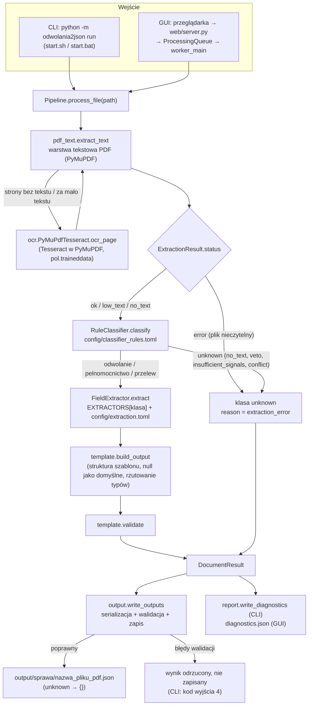
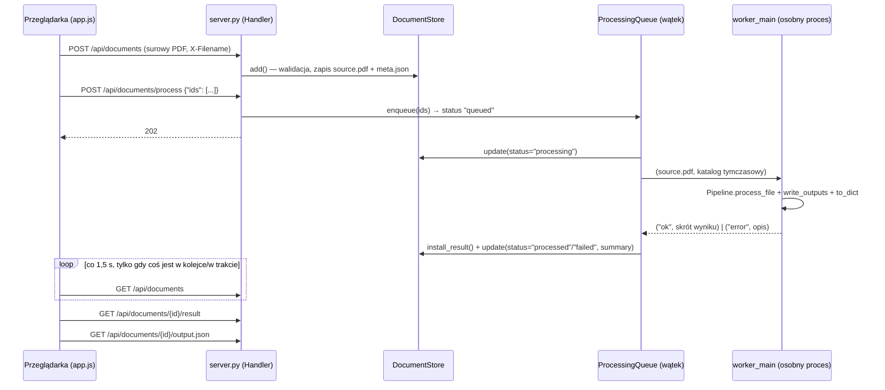

# Odwołania2JSON — architektura systemu

Dokument opisuje **rzeczywisty** stan kodu (pakiet `odwolania2json/`, katalog `config/`) na dzień 21.11.2026.
Wszystkie nazwy plików, klas, funkcji i kluczy konfiguracji pochodzą z repozytorium. Tam, gdzie README lub
komentarze w kodzie mówią coś innego niż implementacja, rozbieżność jest opisana wprost (sekcja 17.3).

Praktyczny przewodnik dla programisty (zmiana reguł, dodanie nowej klasy): [`ROZSZERZANIE_SYSTEMU.md`](ROZSZERZANIE_SYSTEMU.md).

---

## 1. Cel i zakres aplikacji

Odwołania2JSON przetwarza dokumenty PDF spraw odwoławczych przed Krajową Izbą Odwoławczą (zadanie UZP, HackNation 2026):

1. wyciąga tekst z PDF (warstwa tekstowa, a dla skanów — OCR),
2. rozpoznaje rodzaj dokumentu: `odwolanie`, `pelnomocnictwo`, `przelew` albo `unknown`,
3. wyodrębnia dane właściwe dla rozpoznanej klasy,
4. zapisuje jeden plik JSON na dokument, w strukturze zgodnej z plikami organizatora (`oczekiwane-json/`).

Zakres:

- przetwarzanie **lokalne, na CPU**, bez LLM i bez zewnętrznych API (w kodzie aplikacji nie ma klienta HTTP —
  jedyne użycia sieci to lokalny serwer GUI na `127.0.0.1` i otwarcie przeglądarki na ten adres),
- deterministyczne reguły (regex + słowniki), bez modeli uczonych,
- dwa interfejsy: CLI (`python -m odwolania2json`) i lokalne GUI (`python -m odwolania2json.web`),
- dokument nierozpoznany → plik z zawartością `{}` (ustalenie organizatora; w kodzie: `config/app.toml`, `[output] unknown = "empty_object"`).

Poza zakresem: dokumenty z wieloma pismami w jednym PDF (klasyfikowane jako całość), łączenie danych między
dokumentami jednej sprawy (każdy PDF jest przetwarzany niezależnie).

## 2. Architektura systemu

System to warstwowy pipeline z wyraźnie oddzielonymi etapami. Każdy etap ma własny moduł i własny typ wyniku.

```
odwolania2json/
├── __main__.py, cli.py        interfejs wiersza poleceń (argparse)
├── parallel.py              równoległe przetwarzanie wielu PDF-ów w trybie wsadowym (`run --workers`)
├── pipeline.py                Pipeline, DocumentResult, ProcessingStatus, find_pdfs — orkiestracja etapów
├── pdf_text.py                extract_text → ExtractionResult (warstwa tekstowa + plan OCR + statystyki)
├── ocr.py                     OcrEngine (Protocol), PyMuPdfTesseract, load_ocr_settings, engine_from_settings
├── normalize.py               clean_text, matching_text, fold_diacritics, count_meaningful_chars
├── classify/
│   ├── base.py                Classifier (Protocol), ClassificationResult, DocumentText, UNKNOWN
│   └── rules.py               RuleClassifier (sterowany config/classifier_rules.toml)
├── extract/
│   ├── __init__.py            FieldExtractor, rejestr EXTRACTORS, EXTRACTION_CONFIG
│   ├── base.py                ExtractionContext, FieldResult
│   ├── template.py            load_template, build_output, validate (szablony config/templates/*.json)
│   ├── normalizers.py         parse_date, parse_amount, normalize_account, normalize_ted, normalize_bzp, clean_person, korekty OCR
│   ├── entities.py            wyszukiwanie podmiotów: nazwa + KRS/NIP/REGON
│   ├── odwolanie.py           extract_odwolanie
│   ├── pelnomocnictwo.py      extract_pelnomocnictwo
│   └── przelew.py             extract_przelew
├── output.py                  write_outputs, load_unknown_mode, OutputExistsError — zapis JSON z walidacją
├── report.py                  write_diagnostics — diagnostyka (*.diag.json, summary.json, summary.csv)
├── evaluation.py, benchmark.py   ewaluacja wewnętrzna (metryki, manifesty) — nie biorą udziału w przetwarzaniu
└── web/                       lokalne GUI
    ├── __main__.py            uruchomienie serwera
    ├── server.py              AppServer, Handler (HTTP + JSON API), make_server, system_info
    ├── documents.py           DocumentStore — magazyn wgranych PDF i metadanych
    ├── processing.py          ProcessingQueue, ProcessRunner, worker_main, process_document
    └── static/                index.html, css/, js/app.js (bez frameworka i bez zasobów z internetu)

config/
├── app.toml                   [output] unknown, [ocr] enabled/language/dpi/tessdata_dir
├── classifier_rules.toml      strefy, próg decyzji, klasy z sygnałami, weta
├── extraction.toml            słowniki ekstrakcji: [przelew.labels], [przelew.exclude], [[czynnosc]]
└── templates/                 odwolanie.json, pelnomocnictwo.json, przelew.json (+ README.md)
ocr/tessdata/pol.traineddata   model języka polskiego dla Tesseracta
```

Zasady podziału odpowiedzialności (sprawdzone w kodzie):

- `Pipeline` nie zna formatu zapisu ani CLI — zwraca `DocumentResult` (`pipeline.py`).
- Klasyfikator i ekstraktor są rozdzielone: ekstraktor dostaje gotową klasę i jej nie zmienia;
  `unknown` nie trafia do ekstrakcji (`Pipeline.process_file`).
- Zapis wyników (`output.py`) i diagnostyki (`report.py`) jest poza pipeline'em; CLI i GUI korzystają z tych samych funkcji.
- GUI nie duplikuje logiki: wywołuje `Pipeline.process_file` i `write_outputs` w osobnym procesie (`web/processing.py`).

## 3. Diagram przepływu danych



## 4. Opis poszczególnych modułów

| Moduł | Najważniejsze elementy | Odpowiedzialność |
|---|---|---|
| `cli.py` | `main`, `_build_parser`, `cmd_run`, `cmd_classify`, `cmd_evaluate`, `cmd_eval`, `cmd_eval_compare`, `cmd_manifest_organizer`, `_make_pipeline`, `build_pipeline` | parsowanie argumentów, budowa `Pipeline`, wywołanie zapisu i diagnostyki, kody wyjścia |
| `parallel.py` | `process_paths`, `default_workers` | pula procesów (spawn), największe pliki najpierw, wyniki w kolejności wejściowej, awaryjny powrót do trybu sekwencyjnego |
| `pipeline.py` | `Pipeline`, `Pipeline.process_file`, `Pipeline.process_dir`, `find_pdfs`, `DocumentResult`, `ProcessingStatus` | kolejność etapów, wynik w pamięci |
| `pdf_text.py` | `extract_text`, `ExtractionResult`, `ExtractionStatus`, `TextSource`, `OcrInfo`, `MIN_CHARS_DOCUMENT`, `MIN_CHARS_PAGE` | tekst per strona, decyzja o OCR, statystyki jakości tekstu |
| `ocr.py` | `OcrEngine` (Protocol), `PyMuPdfTesseract`, `OcrSettings`, `load_ocr_settings`, `find_tessdata`, `engine_from_settings` | silnik OCR i jego konfiguracja |
| `normalize.py` | `clean_text`, `matching_text`, `fold_diacritics`, `count_meaningful_chars` | normalizacja tekstu (do czytania i do dopasowań) |
| `classify/base.py` | `Classifier` (Protocol), `ClassificationResult`, `DocumentText`, `UNKNOWN` | kontrakt klasyfikatora |
| `classify/rules.py` | `RuleClassifier`, `Signal`, `ClassRule`, `Veto`, `RuleConfigError`, `DEFAULT_RULES_PATH` | klasyfikacja regułowa z TOML |
| `extract/__init__.py` | `FieldExtractor`, `EXTRACTORS`, `EXTRACTION_CONFIG` | wybór ekstraktora wg klasy, budowa i walidacja wyniku |
| `extract/base.py` | `ExtractionContext`, `FieldResult` | wejście i wyjście ekstraktorów |
| `extract/template.py` | `load_template`, `build_output`, `validate`, `TemplateError`, `TEMPLATES_DIR` | szablony wyniku i walidacja typów |
| `extract/normalizers.py` | `parse_date`, `parse_amount`, `normalize_account`, `digits_only`, `normalize_ted`, `normalize_bzp`, `clean_person`, `collapse_ws`, `fix_legal_form`, `fix_lone_prepositions`, `fix_ampersand`, `strip_lead_letter`, `account_digits`, `strip_ocr_noise`, `drop_punct_tokens`, `repair_email` | normalizacja wartości i kontekstowe korekty OCR |
| `extract/entities.py` | `find_ids`, `id_clusters`, `name_before`, `clean_name`, `LEGAL_FORM` | podmioty: nazwa z formą prawną + KRS/NIP/REGON |
| `extract/odwolanie.py` | `extract_odwolanie` | pola odwołania |
| `extract/pelnomocnictwo.py` | `extract_pelnomocnictwo` | mocodawcy, podpisujący, pełnomocnicy, PESEL |
| `extract/przelew.py` | `extract_przelew` | pola potwierdzenia przelewu |
| `output.py` | `write_outputs`, `output_path`, `load_unknown_mode`, `OutputExistsError`, `WriteReport`, `APP_CONFIG` | zapis JSON w formacie organizatora |
| `report.py` | `write_diagnostics`, `SUMMARY_FIELDS` | pliki diagnostyczne |
| `evaluation.py` | `evaluate_dirs`, `format_report` | porównanie wyników z referencją (metryka wewnętrzna) |
| `benchmark.py` | `load_manifest`, `run_evaluation`, `compare_reports`, `build_organizer_manifest` | evaluator na manifestach JSONL |
| `web/*` | opisane w sekcji 7 | lokalne GUI |

## 5. Przepływ przetwarzania pojedynczego PDF

Na przykładzie `python -m odwolania2json run` dla pliku `input/sprawa1/dokument.pdf`:

1. **Wyszukanie plików** — `find_pdfs(input)`: wszystkie pliki z rozszerzeniem `.pdf` (bez względu na wielkość liter),
   rekurencyjnie, w stałej (posortowanej) kolejności. Nazwa pliku **nie** wpływa na klasyfikację.
2. **Ekstrakcja tekstu** — `extract_text(path, ocr_engine)`:
   - otwarcie przez `pymupdf.open`; błąd otwarcia lub plik zaszyfrowany → `ExtractionStatus.ERROR`,
   - `page.get_text("text")` dla każdej strony + `clean_text`,
   - ocena ilości tekstu (`count_meaningful_chars`) i plan OCR (`_ocr_plan`),
   - OCR wybranych stron (`_run_ocr`) — tekst OCR zastępuje tekst strony tylko wtedy, gdy zawiera więcej znaków alfanumerycznych,
   - status końcowy: `ok` / `low_text` / `no_text`, źródło tekstu `native` / `ocr` / `mixed` / `none`.
3. **Klasyfikacja** — `RuleClassifier.classify(DocumentText(pages, has_sufficient_text))`; przy statusie `error`
   pipeline sam ustawia `unknown` z powodem `extraction_error`.
4. **Ekstrakcja pól** — tylko gdy `FieldExtractor.supports(label)` (klasa jest w `EXTRACTORS`):
   `FieldExtractor.extract(label, pages)` → `EXTRACTORS[label](ExtractionContext(pages), config)` → `build_output` → `validate`.
5. **Wynik w pamięci** — `DocumentResult(file_name, relative_path, status, doc_class, extraction, classification, fields)`;
   `relative_path` to ścieżka względem katalogu wejściowego (np. `sprawa1/dokument.pdf`).
6. **Zapis** — `write_outputs` → `output/sprawa1/dokument.json` (nazwa jak PDF, rozszerzenie `.json`).
7. **Diagnostyka** — `write_diagnostics` → `diagnostics/sprawa1/dokument.diag.json` + `summary.json` + `summary.csv`.

## 6. Opis CLI

Wejście: `python -m odwolania2json` (`__main__.py` → `cli.main`). Skrypty `start.sh` / `start.bat` uruchamiają
`run --input input --output output --diagnostics diagnostics` z katalogu projektu (preferują `.venv`).

| Polecenie | Działanie | Ważne opcje |
|---|---|---|
| `run [ŚCIEŻKA]` | pełne przetwarzanie: JSON do `--output`, diagnostyka do `--diagnostics` | `--input` (domyślnie `input`), `--output` (`output`), `--diagnostics` (`diagnostics`), `--rules`, `--app-config`, `--no-ocr`, `--save-text`, `--overwrite` |
| `classify [ŚCIEŻKA]` | tekst + klasyfikacja, bez ekstrakcji pól; diagnostyka do `--output` | `--rules`, `--no-ocr`, `--save-text`, `--json` |
| `evaluate` | porównanie katalogu wyników z katalogiem referencyjnym | `--pred`, `--gold`, `--max-mismatches` |
| `eval` | evaluator na manifeście JSONL, raport JSON | `--manifest`, `--report`, `--label`, `--rules`, `--app-config`, `--no-ocr` |
| `eval-compare` | porównanie dwóch raportów `eval` | `--report`, `--fail-on-regression` |
| `manifest-organizer` | manifest dla katalogu `dane` organizatora | `--dane`, `--out` |

Kody wyjścia `run` (`cmd_run`): `0` sukces, `1` brak PDF, `2` błąd argumentów/konfiguracji (także katalog wyników
pokrywający się z wejściowym), `3` pliki wynikowe już istnieją bez `--overwrite`, `4` część wyników odrzucona przez walidację.

Przetwarzanie w CLI jest **sekwencyjne** (jeden dokument po drugim, jeden proces).

## 7. GUI i komunikacja z backendem

Uruchomienie: `python -m odwolania2json.web [--host 127.0.0.1] [--port 8000] [--open] [--data-dir …] [--max-upload-mb 50]`.
Serwer: `web/server.py` — `AppServer` (`ThreadingHTTPServer` z biblioteki standardowej) + `Handler`.
Frontend: `web/static/index.html`, `css/tokens.css`, `css/app.css`, `js/app.js` — aplikacja jednostronicowa z routingiem
po hashu (`#/pulpit`, `#/dokumenty`, `#/dokumenty/<id>`, `#/przetwarzanie`, `#/wyniki`, `#/informacje`).



API (`Handler.do_GET` / `do_POST` / `do_DELETE`):

| Metoda i ścieżka | Działanie |
|---|---|
| `GET /api/info` | `system_info()` — klasy z `RuleClassifier.labels`, klucze szablonów, stan OCR, kategorie czynności z `extraction.toml` |
| `GET /api/documents` | lista dokumentów z magazynu (status, pozycja w kolejce, skrót wyniku) |
| `POST /api/documents` | dodanie PDF (ciało = plik, nazwa w nagłówku `X-Filename`) |
| `DELETE /api/documents/{id}` | usunięcie (409, gdy dokument jest przetwarzany) |
| `POST /api/documents/process` | dodanie dokumentów do kolejki → 202 |
| `GET /api/documents/{id}/result` | `diagnostics.json` + treść `output.json` |
| `GET /api/documents/{id}/output.json` | pobranie zapisanego pliku wyniku (nazwa `<nazwa PDF>.json`) |

Elementy techniczne:

- **Magazyn** (`web/documents.py`, `DocumentStore`): poza katalogiem projektu (`default_data_dir()`; zmiana `--data-dir`
  lub `ODWOLANIA_DATA_DIR`); układ `<id>/source.pdf`, `<id>/meta.json`, `<id>/result/{output.json, diagnostics.json}`;
  `id` losowe (`secrets.token_hex(16)`), nazwa od użytkownika tylko w metadanych; `source.pdf` tylko do odczytu;
  zapisy atomowe (`_write_meta`, `install_result`).
- **Przetwarzanie** (`web/processing.py`): `ProcessingQueue` (kolejka w pamięci, jeden wątek-dyspozytor),
  `ProcessRunner` (jeden proces roboczy `multiprocessing` w trybie spawn, limit czasu `timeout_for(pages)` =
  `TIMEOUT_BASE` 60 s + `TIMEOUT_PER_PAGE` 45 s × strony, restart po awarii lub przekroczeniu czasu),
  `process_document` (jedyne miejsce wywołujące pipeline w GUI).
- **Bezpieczeństwo**: nasłuch domyślnie na `127.0.0.1`; żądania zmieniające stan wymagają nagłówka
  `X-Requested-With: odwolania2json` i hosta `127.0.0.1`/`localhost`/`::1` (`Handler._mutation_allowed`);
  identyfikatory sprawdzane wzorcem `ID_RE`; pliki statyczne tylko z `web/static/`.
- **Zgodność z CLI**: wynik GUI powstaje przez te same `Pipeline.process_file` i `write_outputs`, z konfiguracją
  domyślną (`config/classifier_rules.toml`, `config/app.toml`). GUI nie ma odpowiednika opcji `--rules` / `--app-config`.

## 8. Ekstrakcja tekstu i OCR

- Biblioteka: PyMuPDF (`pymupdf`). Tekst per strona: `page.get_text("text")` w kolejności strumienia treści
  (bez sortowania geometrycznego — celowo, patrz docstring `extract_text`).
- Normalizacja tekstu do czytania: `normalize.clean_text` (NFC, ujednolicone spacje, usunięte znaki sterujące,
  zachowane podziały linii).
- Progi (stałe w `pdf_text.py`, **nie** w konfiguracji): `MIN_CHARS_DOCUMENT = 200` znaków alfanumerycznych
  (poniżej → `low_text` / `no_text`), `MIN_CHARS_PAGE = 30` (poniżej strona jest traktowana jako pusta).
- Plan OCR (`_ocr_plan`): `no_text` — OCR stron bez tekstu; `low_text` — stron bez tekstu lub z obrazami;
  `scanned_pages` — dokument ma tekst, ale część stron to obrazy bez tekstu. OCR obejmuje **wszystkie** takie strony
  (bez limitu liczby stron).
- Silnik: `PyMuPdfTesseract` — Tesseract wbudowany w PyMuPDF (`page.get_textpage_ocr(language, dpi, full=True, tessdata)`).
  Model: `ocr/tessdata/pol.traineddata`, wyszukiwany przez `find_tessdata` (kolejność: `ocr.tessdata_dir` z konfiguracji,
  `ocr/tessdata/`, `TESSDATA_PREFIX`, katalog wykryty przez PyMuPDF).
- Konfiguracja: `config/app.toml`, sekcja `[ocr]` — `enabled`, `language`, `dpi` (72–600, sprawdzane w `load_ocr_settings`),
  `tessdata_dir`; w CLI dodatkowo `--no-ocr`.
- Odporność: błąd OCR jednej strony trafia do `OcrInfo.errors`, a dokument zachowuje tekst natywny;
  brak modelu → `OcrInfo.status = "unavailable"` (CLI wypisuje ostrzeżenie).

## 9. Klasyfikacja

`RuleClassifier` (`classify/rules.py`), konfiguracja `config/classifier_rules.toml`:

- **Strefy**: `head` — pierwsze `zones.head_chars` (3000) znaków, `body` — pierwsze `zones.body_pages` (3) strony.
  Dopasowanie na tekście z `matching_text` (małe litery, scalone rozstrzelone słowa, połączone przeniesienia),
  każdy wzorzec także w wersji bez polskich znaków (`fold_diacritics`) — odporność na OCR.
- **Klasa** `[classes.<nazwa>]`: `description`, `min_score`, `min_signals`, `required_any` oraz lista
  `[[classes.<nazwa>.signals]]` z polami `name`, `pattern` (regex), `zone`, `weight`, `min_count`.
- **Kandydat**: suma wag ≥ `min_score` **i** liczba różnych sygnałów ≥ `min_signals` **i** co najmniej jeden sygnał z `required_any`.
- **Weta** `[[veto]]` (`name`, `zone`, `all` — wszystkie wzorce muszą pasować) wymuszają `unknown`
  (obecnie: `orzeczenie_kio`, `ogloszenie_bzp`, `ogloszenie_ted`, `zgloszenie_przystapienia`).
- **Decyzja**: brak wystarczającego tekstu → `no_text`; weto → `veto:<nazwa>`; brak kandydatów → `insufficient_signals`;
  kilku kandydatów z przewagą < `decision.min_margin` (3.0) → `conflict:<klasy>`; inaczej klasa z najwyższą punktacją (`match`).
- Wynik `ClassificationResult` zawiera `scores`, `signals` (dopasowane sygnały per klasa) i `candidates` —
  zapisywane w diagnostyce i pokazywane w GUI.
- Walidacja konfiguracji przy wczytaniu: błędny regex, nieznana strefa, `required_any` wskazujące nieistniejący sygnał,
  klasa o nazwie `unknown` → `RuleConfigError`.

Klasy klasyfikatora są w pełni definiowane w TOML — `RuleClassifier.labels` to lista sekcji `[classes.*]`.

## 10. Ekstrakcja danych

`FieldExtractor` (`extract/__init__.py`):

```python
EXTRACTORS = {"odwolanie": extract_odwolanie, "pelnomocnictwo": extract_pelnomocnictwo, "przelew": extract_przelew}
```

- `FieldExtractor.__init__` wczytuje `config/extraction.toml` i szablony **tylko dla klas z `EXTRACTORS`**.
- `FieldExtractor.extract(label, pages)`: `ExtractionContext(pages)` (stosuje `fix_legal_form` i `fix_lone_prepositions`;
  udostępnia `text`, `lines`, `flat`) → funkcja z rejestru → `build_output(template, data)` → `validate(data, template)`.
  Wyjątek w ekstraktorze jest przechwytywany: wynik ma same `null`, a błąd trafia do `FieldResult.warnings`.
- `FieldResult`: `data` (wynik), `evidence` (ścieżka pola → fragment źródłowy), `warnings`, `validation_errors`.

Ekstraktory (logika w Pythonie, słowniki częściowo w TOML):

| Ekstraktor | Metoda | Co pochodzi z `config/extraction.toml` | Co jest w kodzie |
|---|---|---|---|
| `extract_przelew` | etykieta → wartość typowana w oknie po etykiecie (`_find_after_labels`), tytuł wielowierszowy (`_extract_title`), uzupełnianie rachunku bez etykiety | `[przelew.labels]` (etykiety 6 pól, kolejność = priorytet), `[przelew.exclude]` (dystraktory) | nazwy pól i klucz `przelew_bankowy`, wzorce wartości (`_AMOUNT_VALUE`, `_REF_VALUE`, `DATE_RE`, `ACCOUNT_RE`), okna (`WINDOW`, `ACCOUNT_WINDOW_TABLE`), `_OTHER_LABELS`, `_TITLE_STOP` |
| `extract_odwolanie` | nagłówek „miejscowość, data” (`_header`), bloki ról (`_blocks`: Odwołujący, Zamawiający, „dotyczy”), podmioty (`entities.py`), czynność z pierwszego zarzutu (`_czynnosc`) | `[[czynnosc]]` (12 kategorii: `id`, `opis`, `patterns`; kolejność = priorytet) | struktura `OdwolanieKIO` / `Odwolujacy` / `Zamawiajacy` / `ZamowieniePubliczne`, wzorce bloków i numerów (`_MARKERS`, `_REF_NO`, `_TED_HINT`, `_TITLE`…) |
| `extract_pelnomocnictwo` | mocodawcy z klastrów identyfikatorów (`_mocodawcy`, `id_clusters`), podpisy (`_signatures`), pełnomocnicy (`_pelnomocnicy`), PESEL | **nic** (parametr `cfg` nie jest używany) | całość: wzorce, słownik `_ROLE_WORDS`, struktura `mocodawca` / `pelnomocnicy` |

## 11. Normalizacja danych

Dwa poziomy:

1. **Tekst** (`normalize.py`): `clean_text` (do czytania i ekstrakcji), `matching_text` + `fold_diacritics` (do klasyfikacji).
2. **Wartości** (`extract/normalizers.py`), wywoływane bezpośrednio z ekstraktorów:

| Funkcja | Wynik |
|---|---|
| `parse_date` | ISO `YYYY-MM-DD` z formatów „3 września 2026”, „03.09.2026”, „3-9-2026”, „2026-09-03”, „3 IX 2026” |
| `parse_amount` | liczba zmiennoprzecinkowa („7 500,00 PLN” → `7500.0`) |
| `normalize_account` | 26 cyfr bez spacji; prefiks „PL” z dokumentu zachowany tylko przy `[przelew] keep_country_prefix = true` w `config/extraction.toml` (domyślnie wyłączone — patrz 17.3) |
| `digits_only` | KRS/NIP (10 cyfr), REGON (9 lub 14) |
| `normalize_ted` / `normalize_bzp` | `NNNNNN-YYYY` / `YYYY/BZPNNNNNNNN[/NN]` |
| `clean_person`, `collapse_ws`, `strip_ocr_noise`, `drop_punct_tokens` | czyszczenie nazw i osób |
| `fix_legal_form`, `fix_lone_prepositions`, `repair_email` | kontekstowe korekty typowych błędów OCR (bez globalnych zamian znaków) |

Przypisanie normalizatora do pola jest zapisane w kodzie ekstraktora (np. `out["kwota"] = parse_amount(raw_amount)`
w `extract_przelew`), nie w konfiguracji.

## 12. Walidacja

- **Szablony** (`config/templates/<klasa>.json`): struktura wyniku, w której liście są deklaracjami typu
  `string|null`, `date|null`, `int|null`, `number|null`; tablica = lista obiektów o strukturze jedynego elementu.
  Poprawność szablonu sprawdza `load_template` (`_check_template`).
- **Budowa wyniku** (`build_output`): dokładnie struktura szablonu, kolejność kluczy z szablonu, brakujące wartości = `null`,
  nadmiarowe klucze pomijane, rzutowanie typów (`_coerce`; wartość nierzutowalna → `null`, data spoza formatu ISO → `null`);
  pusta lista → jeden element z wartościami `null`.
- **Walidacja** (`validate`): brakujące i nadmiarowe klucze, typy, `null` tylko przy `|null`, format daty.
- **Przed zapisem** (`output._serialize`): wynik z `validation_errors` nie jest zapisywany; dodatkowo serializacja
  i ponowne wczytanie JSON muszą dać te same dane.

Typ wyniku można zmienić w szablonie bez kodu (np. `pelnomocnicy[].pesel` z `string|null` na `int|null` — test
`test_pesel_type_is_configurable_via_template`). Reguł biznesowych (np. „NIP ma 10 cyfr”) walidacja szablonu nie sprawdza —
te ograniczenia są w ekstraktorach i normalizatorach.

## 13. Generowanie i zapisywanie JSON

`output.write_outputs(results, out_dir, unknown_mode, overwrite)`:

- ścieżka: `output_path(out_dir, result)` = `out_dir / relative_path` z rozszerzeniem `.json`
  (`input/sprawa1/potwierdzenie_przelewu.pdf` → `output/sprawa1/potwierdzenie_przelewu.json`; spacje w nazwach zachowane),
- dokument bez pól (`fields is None` — `unknown` albo klasa bez ekstraktora): treść `{}\n` dla `unknown = "empty_object"`
  (ustawienie domyślne) albo pusty plik dla `"empty_file"`,
- pozostałe: `json.dumps(data, ensure_ascii=False, indent=2)` + nowa linia, UTF-8,
- bez `--overwrite` istniejące pliki wynikowe przerywają zapis (`OutputExistsError`, kod 3) — przed zapisem czegokolwiek.

## 14. Diagnostyka i obsługa błędów

Diagnostyka:

- CLI: `report.write_diagnostics` → `<diag>/<ścieżka>.diag.json` (`DocumentResult.to_dict()` — klasyfikacja ze sygnałami,
  statystyki ekstrakcji, OCR, pola z `evidence`/`warnings`/`validation_errors`; **bez pełnego tekstu**),
  `summary.json`, `summary.csv`; z `--save-text` także pełny tekst `.txt` (opcja świadomie włączana — zawiera dane z dokumentu).
- GUI: `<id>/result/diagnostics.json` (to samo `to_dict()` + wersja aplikacji, czas, odrzucenia walidacji), widoczne w szczegółach dokumentu.

Obsługa błędów (zasada: błąd jednego dokumentu nie zatrzymuje pozostałych):

| Sytuacja | Zachowanie |
|---|---|
| plik nieczytelny / zaszyfrowany | `ExtractionStatus.ERROR` → `unknown` (`extraction_error`) → `{}`; w GUI status „Błąd przetwarzania” |
| brak tekstu, OCR niedostępny | `unknown` (`no_text`); CLI wypisuje ostrzeżenie o OCR |
| błąd OCR strony | wpis w `OcrInfo.errors`, tekst natywny strony zachowany |
| wyjątek w ekstraktorze | `FieldResult.warnings`, pola `null` |
| wynik niezgodny ze szablonem | nie zapisany; CLI kod 4 i lista błędów; GUI status „Błąd przetwarzania” |
| błąd konfiguracji (TOML, regex, OCR dpi) | CLI kod 2 z komunikatem |
| GUI: zawieszenie lub awaria procesu roboczego | limit czasu / restart procesu, błąd tylko tego dokumentu |

## 15. Konfiguracja — co można zmienić bez modyfikacji kodu

| Plik | Klucze | Wpływ |
|---|---|---|
| `config/classifier_rules.toml` | `[zones]` `head_chars`, `body_pages`; `[decision]` `min_margin`; `[classes.*]` (`description`, `min_score`, `min_signals`, `required_any`, `signals`); `[[veto]]` | rozpoznawanie klas, dodawanie/zmiana klas klasyfikatora, weta |
| `config/extraction.toml` | `[przelew.labels]`, `[przelew.exclude]`, `[[czynnosc]]` | etykiety pól przelewu i dystraktory; kategorie zaskarżonej czynności (identyfikator, opis, wzorce, priorytet) |
| `config/templates/<klasa>.json` | struktura, kolejność kluczy, typy liści | kształt i typy wyniku JSON |
| `config/app.toml` | `[output] unknown`; `[ocr] enabled`, `language`, `dpi`, `tessdata_dir` | format wyniku dla `unknown`, OCR |
| argumenty CLI | `--rules`, `--app-config`, `--no-ocr`, `--save-text`, `--overwrite` | alternatywne pliki konfiguracji bez podmiany domyślnych |
| argumenty GUI | `--host`, `--port`, `--data-dir`, `--max-upload-mb`; zmienna `ODWOLANIA_DATA_DIR` | serwer i magazyn |

Nie są konfigurowalne (stałe w kodzie): progi tekstu `MIN_CHARS_DOCUMENT` / `MIN_CHARS_PAGE` (`pdf_text.py`),
lista ekstraktorów `EXTRACTORS`, wzorce i okna wyszukiwania w ekstraktorach, przypisanie normalizatorów do pól,
etykiety klas w GUI (`LABELS` w `web/static/js/app.js`), limity czasu GUI (`TIMEOUT_BASE`, `TIMEOUT_PER_PAGE`).

## 16. Obecna elastyczność architektury

Elementy rzeczywiście elastyczne (potwierdzone w kodzie i testach):

- **Klasy klasyfikatora z konfiguracji** — `RuleClassifier` buduje reguły z `config["classes"]`; test
  `test_new_class_can_be_added_by_config_only` (`tests/test_classifier.py`) dodaje klasę wyłącznie przez słownik konfiguracji.
  Sprawdzone także ręcznie: klasa dodana tylko w TOML jest rozpoznawana z powodem `match`.
- **Reguły rozpoznawania** — wzorce, wagi, progi, strefy i weta w TOML, z walidacją przy wczytaniu (`RuleConfigError`).
- **Kształt i typy wyniku** — szablony JSON; `build_output` i `validate` działają dla dowolnego szablonu.
- **Słowniki ekstrakcji** — etykiety pól przelewu i kategorie czynności w `extraction.toml`.
- **Wymienne komponenty przez interfejsy** — `Classifier` i `OcrEngine` to `Protocol`; `Pipeline` przyjmuje własny
  klasyfikator, ekstraktor i silnik OCR (używane w testach).
- **Jeden pipeline dla CLI i GUI** — brak duplikacji logiki.

### Ocena elastyczności

| Element | Obecnie konfigurowalny? | Gdzie? | Czy wymaga kodu Python? | Potencjalny kierunek |
|---|---|---|---|---|
| Klasy dokumentów | częściowo | `[classes.*]` w `config/classifier_rules.toml` (klasyfikacja); szablon w `config/templates/` | **tak** — bez wpisu w `EXTRACTORS` klasa daje tylko `{}`; GUI wymaga szablonu (`/api/info`) | rejestr klas i ekstraktorów w konfiguracji (wariant B) |
| Reguły klasyfikacji | **tak** | `config/classifier_rules.toml` (sygnały, wagi, progi, strefy, weta) | nie | — (już spełnione) |
| Pola ekstrakcji | częściowo | struktura i typy: `config/templates/<klasa>.json` | **tak** — ekstraktor musi zwrócić słownik o tej strukturze | deklaracja pól z metodą ekstrakcji w TOML (wariant A) |
| Reguły ekstrakcji | częściowo | `[przelew.labels]`, `[przelew.exclude]`, `[[czynnosc]]` w `config/extraction.toml` | **tak** — wzorce, okna, logika bloków i list w `extract/*.py`; pełnomocnictwo w całości w kodzie | generyczny ekstraktor „etykieta → typ wartości” (wariant A) |
| Mapowanie danych | nie | przypisanie wartości do kluczy w funkcjach `extract_*` (np. `res.data = {"przelew_bankowy": out}`) | **tak** | mapowanie pola → ścieżka JSON w konfiguracji (wariant A) |
| Normalizacja | nie | `extract/normalizers.py`, wywołania w ekstraktorach | **tak** | nazwane normalizatory wybierane w konfiguracji pola (wariant A) |
| Walidacja | częściowo | typy i struktura w szablonach (`template.py`) | dla reguł biznesowych (długości, sumy kontrolne) — **tak** | reguły walidacji per pole w szablonie/konfiguracji |
| Obsługa nowych klas | częściowo | klasyfikacja: TOML; wynik: szablon | **tak** — ekstraktor, rejestr `EXTRACTORS`, testy z listą klas, etykieta w GUI | wariant A + B |

## 17. Obecne ograniczenia architektury

### 17.1. Ograniczenia elastyczności

1. **Ekstrakcja jest kodem.** `FieldExtractor.supports(label)` to `label in EXTRACTORS`; rejestr jest słownikiem w
   `extract/__init__.py`. Klasa zdefiniowana tylko w TOML jest rozpoznawana, ale ma `fields = None` i zapisywany jest `{}` —
   wynik **nie do odróżnienia od `unknown`** w pliku JSON (różnica widoczna tylko w diagnostyce i w GUI).
2. **Szablony są wczytywane tylko dla klas z `EXTRACTORS`** (`FieldExtractor.__init__`), ale `system_info()` w `web/server.py`
   wywołuje `load_template` dla **każdej** klasy klasyfikatora. Klasa w TOML bez pliku szablonu powoduje błąd `TemplateError`
   w `GET /api/info` (sprawdzone) — GUI pokazuje wtedy komunikat o braku informacji o systemie.
3. **Mapowanie pól i normalizatory są w kodzie** — konfiguracja nie opisuje, z jakiej etykiety/wzorca pochodzi wartość
   ani jak ją znormalizować (poza słownikami przelewu i czynności).
4. **Ekstraktor pełnomocnictwa nie korzysta z konfiguracji** (`cfg` nieużywany).
5. **Testy zawierają listy klas**: `tests/test_classifier.py::test_labels_come_from_config`,
   `tests/test_template.py::test_templates_have_organizer_keys`, `tests/test_web.py` (lista klas z `/api/info`) —
   dodanie klasy wymaga ich aktualizacji.
6. **Etykiety klas w GUI** są w `web/static/js/app.js` (`LABELS`); nowa klasa wyświetla się pod surową nazwą
   (opis z TOML jest dostępny w `/api/info`, ale lista i szczegóły dokumentu go nie używają).

### 17.2. Ograniczenia funkcjonalne i wydajnościowe

- Przetwarzanie sekwencyjne (CLI i GUI) — OCR skanu ok. 13 s średnio na dokument na Apple Silicon (pomiar na 30 skanach
  organizatora), co ma znaczenie przy limicie organizatora 150 PDF / 45 min.
- OCR obejmuje wszystkie strony bez tekstu (bez limitu), klasyfikacja tylko pierwsze `body_pages` stron.
- Dokument z kilkoma pismami w jednym PDF jest klasyfikowany jako całość.
- Imiona i nazwiska w przypadkach zależnych nie są odmieniane do mianownika.
- Każdy PDF jest przetwarzany niezależnie (brak modelu „sprawy”).

### 17.3. Rozbieżności między dokumentacją/ustaleniami a kodem

| Miejsce | Deklaracja | Rzeczywistość w kodzie |
|---|---|---|
| `README.md` („Klasyfikacja”) i komentarz w nagłówku `config/classifier_rules.toml` | „Dodanie nowej klasy = nowa sekcja … kod się nie zmienia” / „Nową klasę dodaje się sekcją w pliku TOML” | prawda tylko dla **klasyfikatora**; ekstrakcja wymaga kodu (17.1 p. 1–2) |
| Ustalenie organizatora (rachunki bankowe) | numer rachunku bez białych znaków, **z prefiksem kraju, jeśli występuje w dokumencie** | przełącznik `keep_country_prefix` (`config/extraction.toml`); domyślnie wyłączony, bo przykładowe JSON-y organizatora pomijają „PL” w 120 z 122 rachunków (z „PL” tylko 2 skany) — decyzja zespołu |
| Ustalenie organizatora (nowe klasy) | dodawanie klas przez plik konfiguracyjny | spełnione częściowo (klasyfikacja tak, ekstrakcja nie) |
| `config/extraction.toml` (komentarz w nagłówku) | „Zmiana etykiet/wzorców nie wymaga zmian w kodzie” | prawda dla zawartości pliku (przelew, czynności); większość wzorców ekstrakcji jest w kodzie |
| `README.md` („Testy”) | „~215 testów” | 286 testów + 1 oznaczony `xfail` (stan po P13.4) |
| `odwolania2json/__init__.py` (docstring) | „(w kolejnych etapach) ekstrakcja danych” | ekstrakcja jest zaimplementowana |

## 18. Jak obecnie dodać nową klasę dokumentu (skrót)

Pełna instrukcja z przykładami: [`ROZSZERZANIE_SYSTEMU.md`, sekcja 6](ROZSZERZANIE_SYSTEMU.md#6-jak-obecnie-dodać-nowy-typ-dokumentu).

1. `config/classifier_rules.toml` — sekcja `[classes.<nazwa>]` z sygnałami (konfiguracja).
2. `config/templates/<nazwa>.json` — szablon wyniku (konfiguracja; wymagany także przez GUI).
3. Opcjonalnie `config/extraction.toml` — słowniki dla nowego ekstraktora (konfiguracja).
4. `odwolania2json/extract/<nazwa>.py` — funkcja `extract_<nazwa>(ctx: ExtractionContext, cfg: dict) -> FieldResult` (**kod**).
5. `odwolania2json/extract/__init__.py` — import i wpis w `EXTRACTORS` (**kod**).
6. `odwolania2json/web/static/js/app.js` — opcjonalnie etykieta w `LABELS` (**kod**, tylko wygląd).
7. Testy: nowe przypadki + aktualizacja testów z listą klas (sekcja 17.1 p. 5).

Bez kroków 4–5 nowa klasa jest rozpoznawana, ale wynikiem jest `{}`.

## 19. Potencjalne kierunki zwiększenia elastyczności

Warianty do rozważenia w kolejnym etapie (**żaden nie jest zaimplementowany**):

### Wariant A — ekstraktor deklaratywny dla nowych klas

Nowy, generyczny ekstraktor sterowany konfiguracją (np. `[extraction.<klasa>.fields.<pole>]` z listą etykiet,
typem wartości `date`/`amount`/`account`/`regex`, oknem wyszukiwania, nazwą normalizatora i ścieżką w JSON),
używany **tylko dla klas bez dedykowanego ekstraktora** w `EXTRACTORS`. Mechanizm podobny do już działającego
`_find_after_labels` w `extract_przelew` i słowników `[przelew.labels]`.

- Zalety: nowa klasa „płaska” (etykieta → wartość) bez kodu Pythona; trzy istniejące ekstraktory bez zmian (brak ryzyka regresji
  na przetestowanych klasach); bezpośrednia odpowiedź na ustalenia organizatora o konfiguracji reguł, mapowania i walidacji.
- Wady: generyczne reguły słabiej radzą sobie z listami podmiotów i blokami (np. konsorcja, wielu pełnomocników) — takie klasy
  nadal wymagałyby kodu albo rozbudowy schematu konfiguracji.
- Ryzyko: niskie dla istniejących klas (osobna ścieżka kodu), średnie dla jakości nowych klas.
- Wpływ na kod: nowy moduł w `extract/`, zmiana `FieldExtractor.supports`/`extract` (fallback), nowy schemat w `extraction.toml`, testy.

### Wariant B — rejestr klas w konfiguracji

Przeniesienie „okablowania” do konfiguracji: przypisanie klasy do ekstraktora (np. nazwa funkcji lub „generyczny”),
normalizatorów wybieranych po nazwie, etykiet wyświetlanych w GUI (z `description` w TOML); `system_info` i GUI odporne
na klasę bez szablonu.

- Zalety: mała zmiana, usuwa twarde listy (rejestr, `LABELS` w GUI, błąd `/api/info`); przygotowuje grunt pod wariant A.
- Wady: sama w sobie nie usuwa potrzeby pisania kodu ekstrakcji.
- Ryzyko: niskie (zmiana „okablowania”, nie logiki ekstrakcji).
- Wpływ na kod: `extract/__init__.py`, `web/server.py` (`system_info`), `web/static/js/app.js`, testy z listami klas.

### Wariant C — lokalny model NER (ok. 0,2 mld parametrów, dozwolony przez organizatora)

Model rozpoznawania encji (organizacje, osoby, daty, kwoty) jako dodatkowe źródło kandydatów wartości, mapowanych na pola
przez konfigurację.

- Zalety: lepsza generalizacja na nowe układy dokumentów i nowe klasy bez pisania reguł.
- Wady: nowe, ciężkie zależności (biblioteka uruchomieniowa modelu i sam model), dodatkowy czas CPU przy limicie 45 min,
  potrzeba danych do strojenia i oceny, licencje modelu, utrata pełnej deterministyczności i przejrzystości „reguła → wartość”.
- Ryzyko: wysokie (regresje jakości, czas, instalacja na maszynie oceniającej).
- Wpływ na kod: nowy moduł, zmiany w ekstraktorach lub warstwa łączenia kandydatów, `requirements.txt`, Dockerfile, ewaluacja.

## 20. Podsumowanie i najważniejsze decyzje techniczne

- **Reguły zamiast modeli** — deterministyczność, przejrzystość (każda wartość ma `evidence`), brak GPU i API, łatwa diagnoza błędów.
  Koszt: ekstrakcja nowych klas wymaga pracy programisty.
- **Rozdzielenie etapów** — tekst → klasyfikacja → ekstrakcja → szablon → walidacja → zapis; każdy etap ma własny typ wyniku i testy.
- **Klasyfikacja w pełni konfigurowalna** — TOML z walidacją, weta dla dokumentów podobnych do klas pozytywnych.
- **Szablon jako kontrakt** — struktura i typy z plików konfiguracyjnych, walidacja przed zapisem, wynik niepoprawny nie jest zapisywany.
- **OCR tylko tam, gdzie potrzebny** — strony z warstwą tekstową nie są OCR-owane; model OCR w repozytorium.
- **Jeden pipeline dla CLI i GUI** — GUI uruchamia pipeline w osobnym procesie z limitem czasu, wynik identyczny jak z CLI.
- **Najważniejsze luki** względem ustaleń organizatora: konfiguracyjne dodawanie klas obejmuje dziś tylko klasyfikację;
  format numerów rachunków (prefiks kraju) nie jest zgodny z ustaleniem nr 7.
